# Product List: Product Listing Page in React

**Assignment 10, Entri Elevate Full Stack Development (Module: React JS)**

A responsive product listing page built with React. Users can browse a grid of products, search by name, filter by category, sort by price or rating, and add items to the cart. Clicking **Add to Cart** logs the product's name to the browser console.

**GitHub repository:** _add the repository link here after pushing_

---

## Features

| Requirement | How it is implemented |
| --- | --- |
| Product data | A mock array of 24 products in `src/data/products.js`, each shaped `{ id, name, price, category, rating, image }`, across 6 categories |
| Product grid | `ProductGrid` renders a `ProductCard` per product, showing the image, name, price, category and rating |
| Search | `SearchBar` filters products by name as you type. Matching ignores case and spaces at either end, and the × button clears the search |
| Category filter | `CategoryFilter` shows one button per category plus **All**. The selected button is highlighted |
| Sorting | `SortSelect` dropdown: **Featured**, **Price: Low to High**, **Price: High to Low**, **Rating: High to Low** |
| Add to Cart | Each card's button calls `onAddToCart(product)`, and `handleAddToCart` in `App.jsx` runs `console.log(product.name)`. The cart badge in the navbar also counts the items added |
| Combined filters | Search, category and sort work together. `ResultsBar` shows the current category and how many products match |
| Empty state | If nothing matches, `EmptyState` shows a "No products found" message with a **Clear filters** button |
| Navigation bar and header | A sticky `Navbar` (brand, links, cart badge) and a `Header` banner with the page title |
| Responsive design | The grid shows 4 columns on desktop, 3 on tablet, 2 on phones and 1 on very narrow screens. On small screens the toolbar stacks and the category buttons wrap onto extra rows |
| Styling | Plain CSS. Each component has its own stylesheet, and shared design tokens live in `src/index.css` |

Additional details:

- If a product image fails to load, the card shows a local placeholder image instead.
- The search box, sort dropdown, category buttons, cart badge and star ratings have labels for screen readers, and every control shows a visible keyboard focus outline.

## Tech stack

- [React 19](https://react.dev/) with hooks (`useState`, `useMemo`, `useRef`, `useId`)
- [Vite 8](https://vite.dev/) for development and production builds
- Plain CSS (no UI library)
- [oxlint](https://oxc.rs/) for linting

## Folder structure

```
product-list/
├── public/
│   └── favicon.svg
├── screenshots/                 # Screenshots of every section of the app
├── src/
│   ├── assets/
│   │   └── image-placeholder.svg   # Shown when a product image fails to load
│   ├── components/
│   │   ├── CategoryFilter.jsx / .css
│   │   ├── EmptyState.jsx / .css
│   │   ├── Header.jsx / .css
│   │   ├── Icons.jsx               # Shared inline SVG icons
│   │   ├── Navbar.jsx / .css
│   │   ├── ProductCard.jsx / .css
│   │   ├── ProductGrid.jsx / .css
│   │   ├── RatingStars.jsx / .css
│   │   ├── ResultsBar.jsx / .css
│   │   ├── SearchBar.jsx / .css
│   │   └── SortSelect.jsx / .css
│   ├── data/
│   │   └── products.js             # Mock product array
│   ├── utils/
│   │   └── productUtils.js         # Filtering, sorting and price formatting helpers
│   ├── App.jsx                     # Holds the page state and puts the components together
│   ├── App.css
│   ├── index.css                   # Design tokens and global styles
│   └── main.jsx
├── index.html
├── package.json
└── vite.config.js
```

### How the components fit together

```
App  (state: searchTerm, category, sortBy, cartCount)
├── Navbar          brand, cartCount
├── Header          title, subtitle
└── main
    ├── SearchBar        value, onChange
    ├── SortSelect       value, onChange, options
    ├── CategoryFilter   categories, selected, onSelect
    ├── ResultsBar       title, shown, total, searchTerm, onClear
    ├── ProductGrid      products, onAddToCart
    │   └── ProductCard  product, onAddToCart
    │       └── RatingStars  rating
    └── EmptyState       title, message, actionLabel, onAction
```

`App` is the only component with page-level state. It computes the visible products with `useMemo` by passing `filterAndSortProducts()` the current search term, category and sort option. Each child component receives data and callbacks through props, so any of them can be reused on another page.

## Getting started

**Requirements:** Node.js 20.19+ or 22.12+ (required by Vite 8), and npm.

```bash
# 1. Install dependencies
npm install

# 2. Start the development server
npm run dev
# then open the URL printed in the terminal (usually http://localhost:5173)

# 3. Build for production and preview the build
npm run build
npm run preview

# 4. Lint the code
npm run lint
```

To see the **Add to Cart** output, open the browser's developer tools (F12, or Cmd + Option + J on macOS), switch to the **Console** tab and click **Add to Cart** on any product.

## Screenshots

### Navigation bar and header
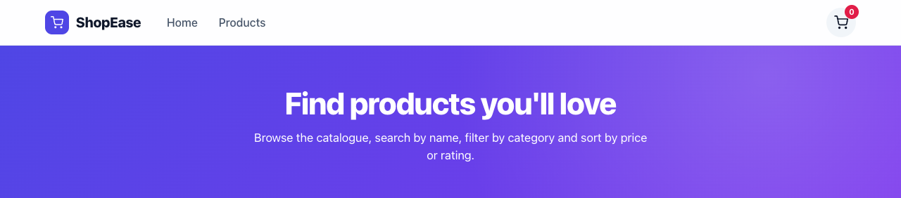

### Product grid (all 24 products)
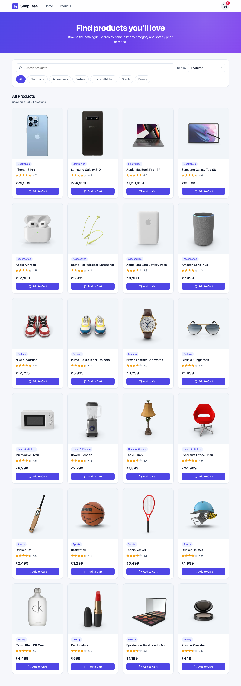

### Search by name ("apple")
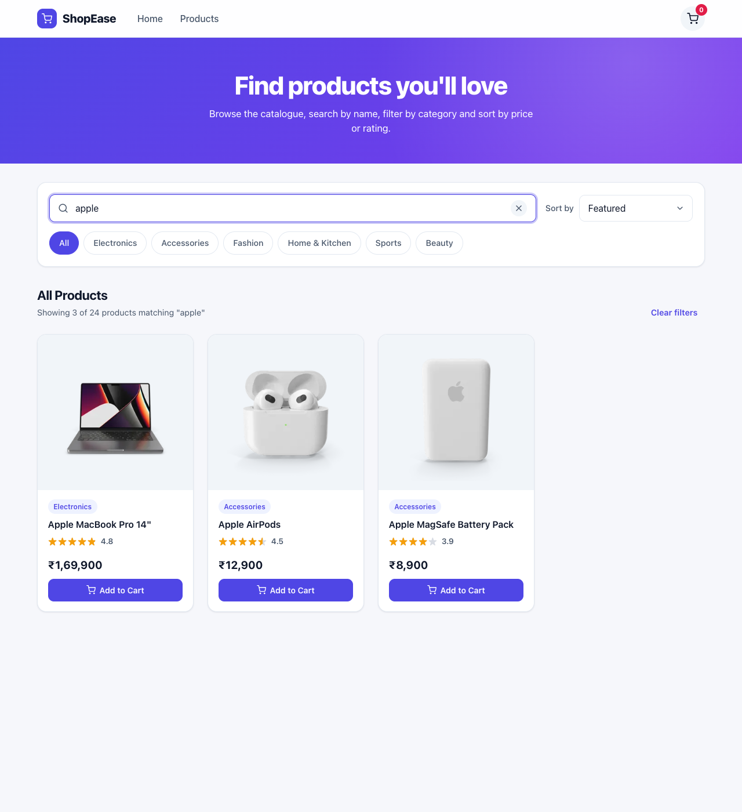

### Category filter ("Sports")
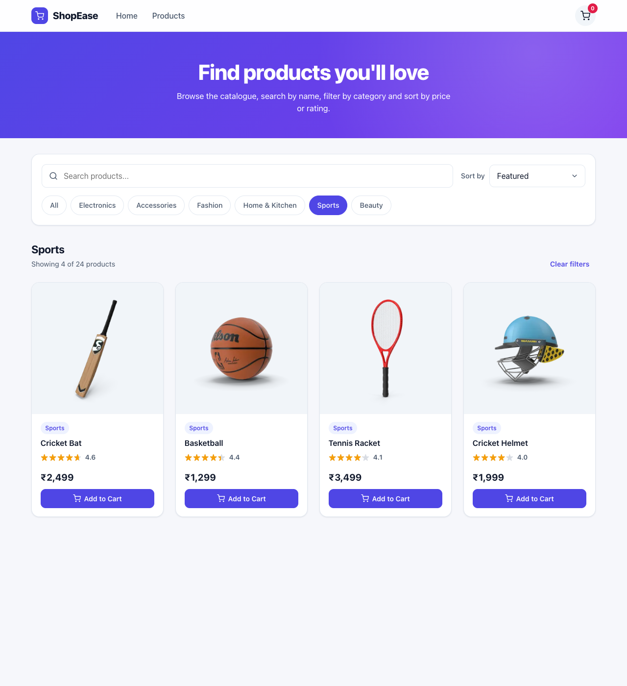

### Sort: price low to high
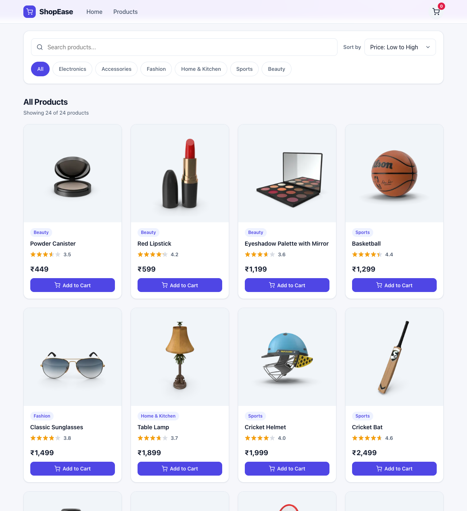

### Sort: price high to low
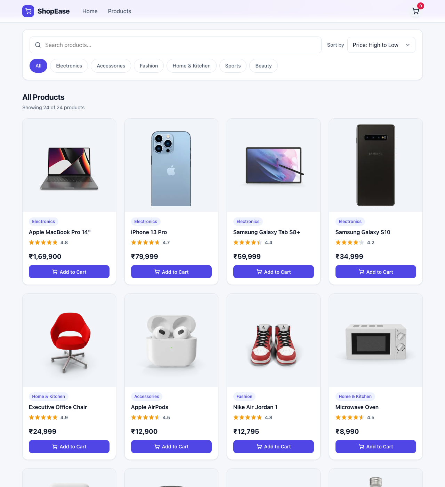

### Sort: rating high to low
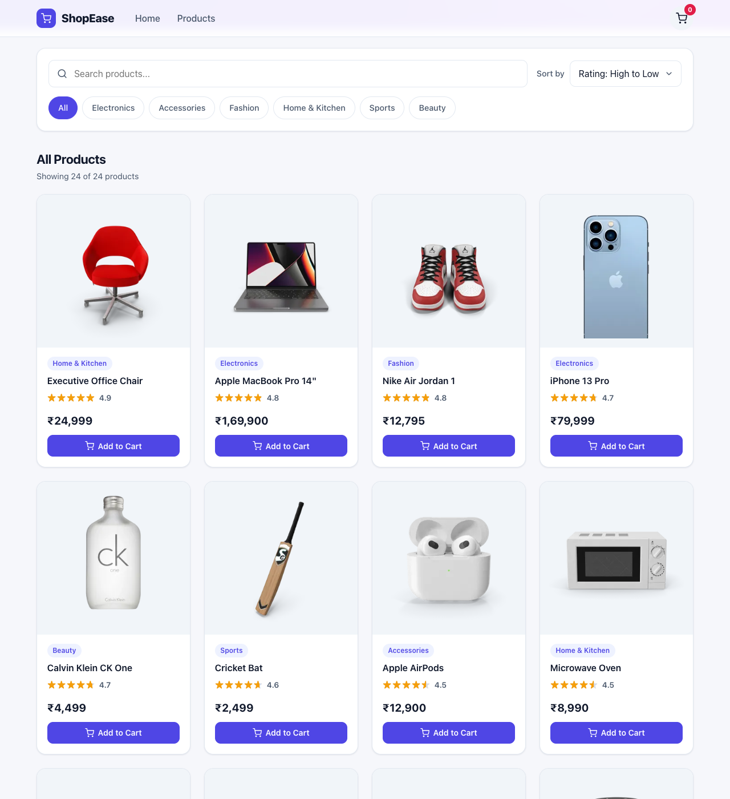

### Combined: "samsung" + Electronics + price high to low
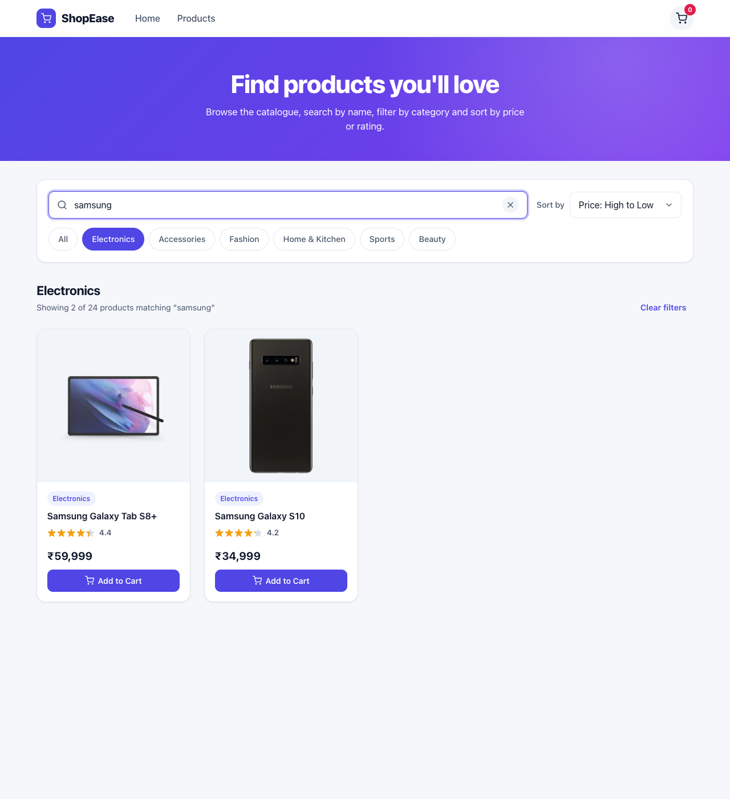

### Empty state
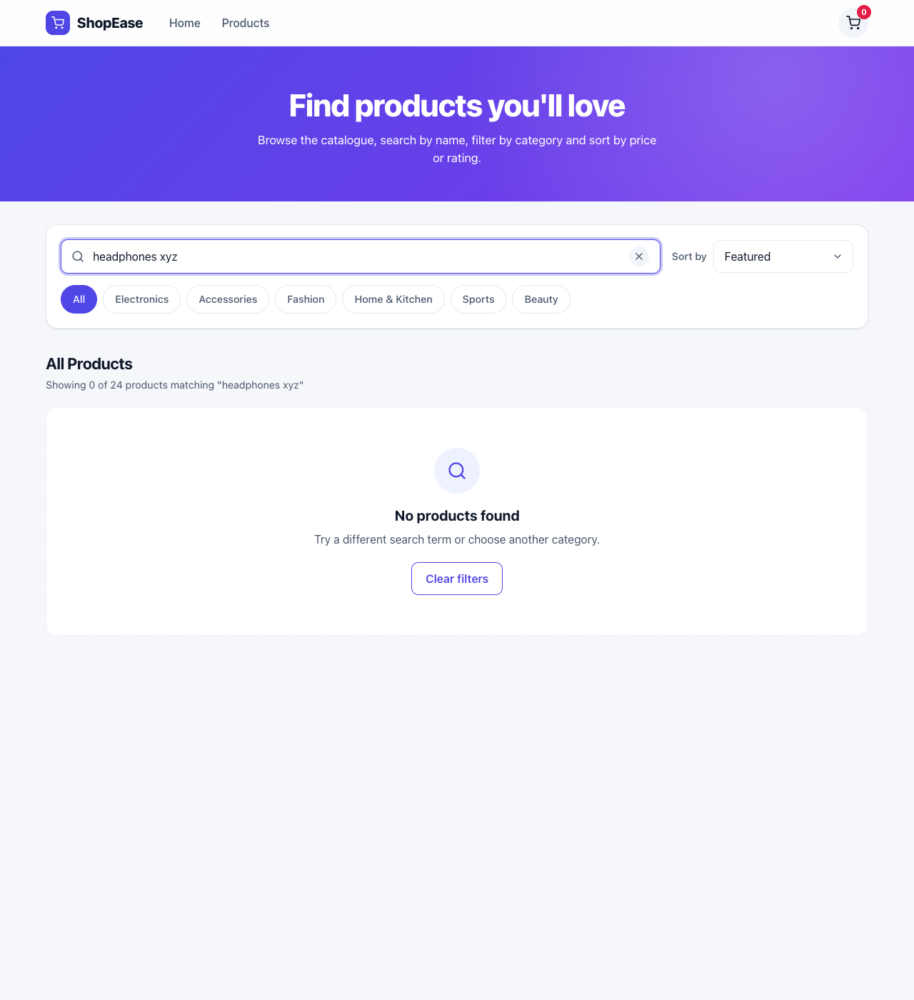

### Add to Cart: product names logged in the console
The app is shown above the Chrome DevTools Console. Each click logged the product's name, and the cart badge shows 3.

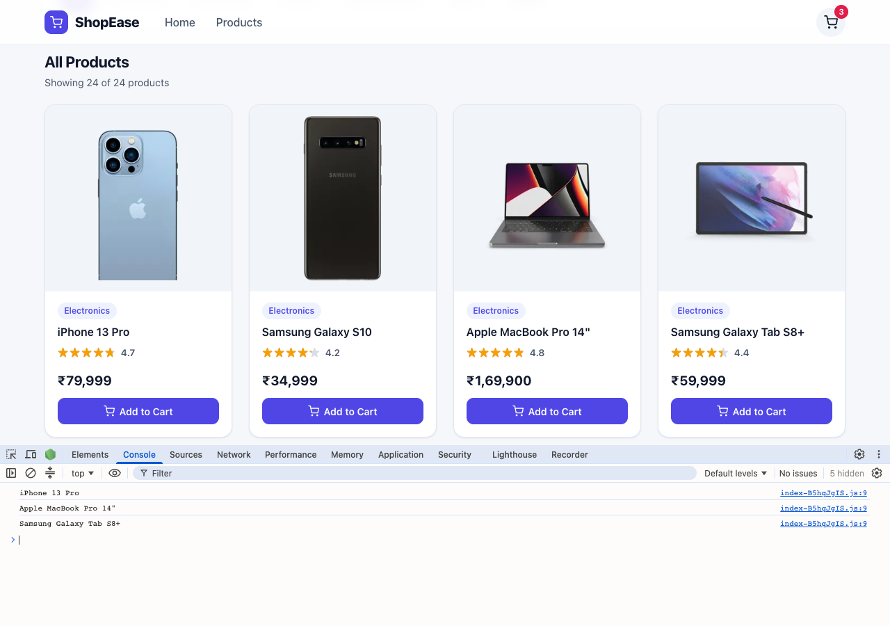

### Responsive: tablet and mobile
| Tablet (768px) | Mobile (375px) | Mobile, filtered |
| --- | --- | --- |
| 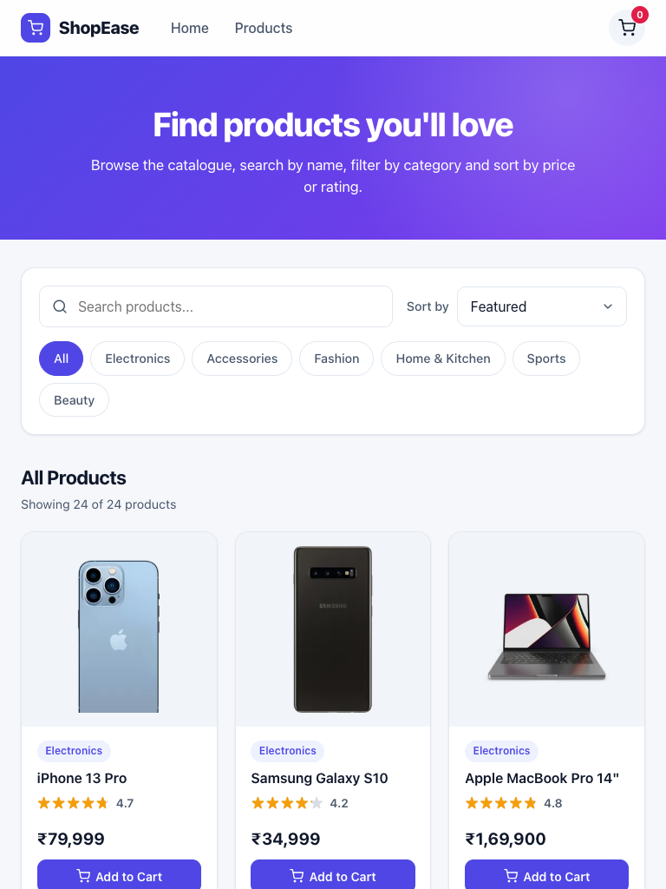 | 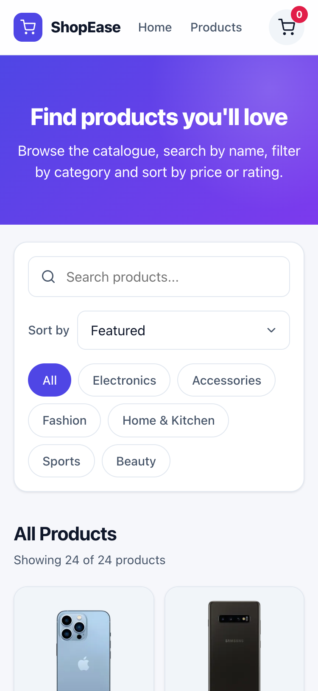 | 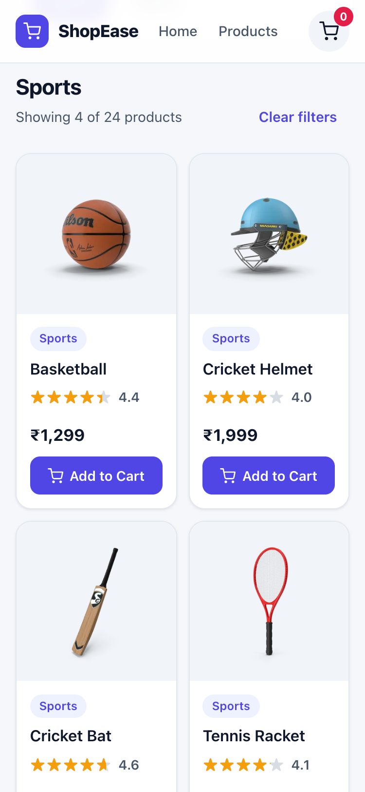 |

## Credits

Product images come from the free [DummyJSON](https://dummyjson.com/) product image CDN. The assignment's sample data used `via.placeholder.com`, which has been shut down, so working image URLs are used instead.
